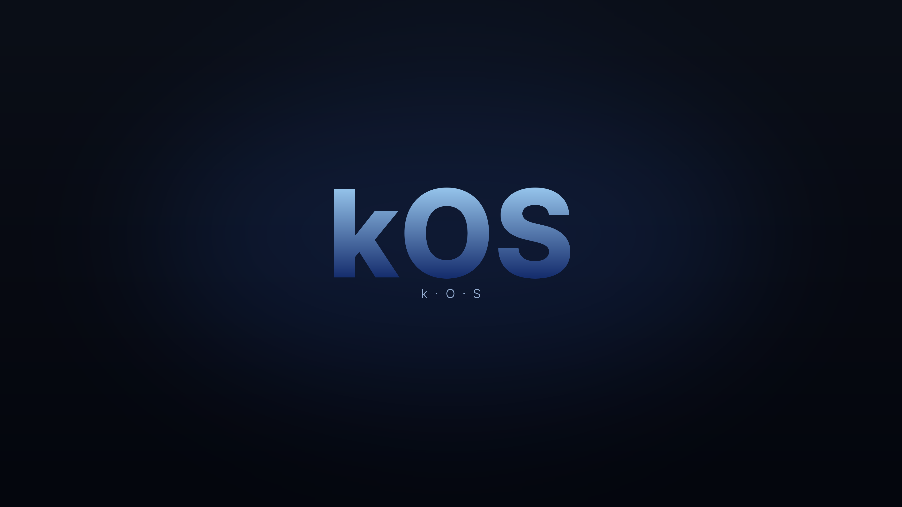
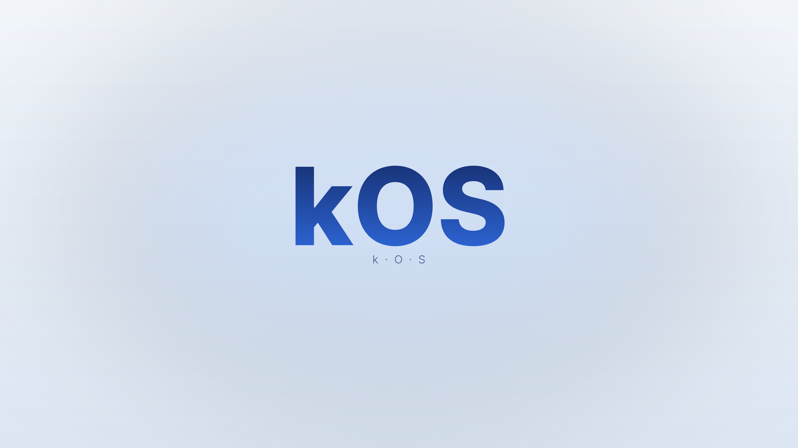

im still lazy so thanks claude for writing this (i cant believe this is an ACTUAL apt package...)

# kOS

A custom Linux distribution built on **Kali** with the **KDE Plasma** desktop. It runs your Windows apps, opens your Apple files, comes with security tools, and has its own clean look.

**Note:** kOS is a personal project made for fun and learning. Because it's based on Kali, it includes security tools. Only use those on devices and networks you own or have permission to test.

## What it does

- **Runs Windows apps.** Wine is built in, so most `.exe` files work.
- **Works with Apple files.** Opens iPhone photos (HEIC) and common Mac file types.
- **Has security tools built in.** The Kali tool set (nmap, Wireshark, Burp, Ghidra, and more).
- **Can send announcements.** A built-in message-of-the-day and pop-up notifications, controlled from one place. ([how it works](https://github.com/KaiDevious/kos-motd-notif-sender))
- **Four desktop themes.** **Lamplight** (warm, lamplit) and **Liquid Glass** (cool frosted gray), plus classic **Dark** and **Light** — each with a matching wallpaper. Switch live with `kos theme <name>`.
- **First-boot welcome.** A one-time **kOS Welcome** wizard on first login — greets you and lets you pick your theme in a couple of clicks.
- **Its own control panel.** The **kOS Control Center** app — a welcome hub and one-click theme switcher, in your app menu.
- **Looks custom all the way down.** Custom wallpaper, boot screen (GRUB), login screen, and terminal logo.
- **Small quality-of-life fixes.** No system beep, reliable networking, and a colored terminal.

## Screenshots

| Dark | Light |
|------|-------|
|  |  |

## How to install

Pick whichever fits you.

### Option 1 — Add the kOS apt repo (easiest)

On a Kali install with the **KDE Plasma** desktop, add the kOS signing key and repository once, then install and set up:

```bash
sudo mkdir -p /usr/share/keyrings
sudo curl -fsSL https://kaidevious.github.io/kOS/apt/kos-archive-keyring.gpg \
  -o /usr/share/keyrings/kos-archive-keyring.gpg
echo 'deb [signed-by=/usr/share/keyrings/kos-archive-keyring.gpg] https://kaidevious.github.io/kOS/apt ./' \
  | sudo tee /etc/apt/sources.list.d/kos.list
sudo apt update
sudo apt install kos-desktop
sudo kos setup
```

The repository is GPG-signed, so apt verifies every package came from kOS — no `[trusted=yes]` needed.

Reboot. After that, `sudo apt update && sudo apt upgrade` keeps kOS up to date like any other package.

### Option 2 — Install a single .deb by hand

1. Download the latest `kos-desktop_*.deb` from [Releases](https://github.com/KaiDevious/kOS/releases) (or the `packaging/` folder).
2. Open a terminal where the file is and run:
   ```bash
   sudo apt install ./kos-desktop_*.deb
   sudo kos setup
   ```
3. Reboot.

### Option 3 — Build it yourself from the source

1. Install Kali with the **KDE Plasma** desktop.
2. Run:
   ```bash
   git clone https://github.com/KaiDevious/kOS
   cd kOS
   sudo bash scripts/kos-setup.sh
   ```
3. Reboot.

The package/setup installs the kOS look, the themes, the Control Center, the announcement tools, and the apps it needs. To change the announcement settings later, edit `/etc/kos/config`.

### A full bootable ISO

A downloadable `kOS.iso` (boot it, click "Install kOS," done — no Kali needed first) is the next milestone. The boot-menu and installer branding for it live in `installer/`. Until it ships, use one of the options above on a Kali base.

## Using kOS

- **Switch themes:** `kos theme lamplight` · `kos theme liquidglass` · `kos theme dark` · `kos theme light` (or use the Control Center).
- **List what's available:** `kos themes`
- **See the command:** `kos help`
- **Open the control panel:** launch **kOS Control Center** from your app menu.

## What's in this repo

```
app/         kOS Control Center (GTK4 app) — native + Flatpak
branding/    wallpapers, logos, boot screen, login screen, KDE themes
scripts/     kos (command), kos-setup.sh (applies the whole kOS look)
installer/   boot-menu and installer branding for building the ISO
packaging/   build scripts + the kos-desktop .deb and apt repo
docs/        the kOS website and build notes
```

## Credits

Built by Kai. Based on [Kali Linux](https://www.kali.org/) and [KDE Plasma](https://kde.org/). The ISO is built with [penguins-eggs](https://penguins-eggs.net/).

## License

The kOS code, scripts, and configs are **GPL-3.0** (see [`LICENSE`](LICENSE)). The software kOS bundles keeps its own licenses. The kOS name and logo are not covered by that license — please don't ship a modified build and call it "kOS."
